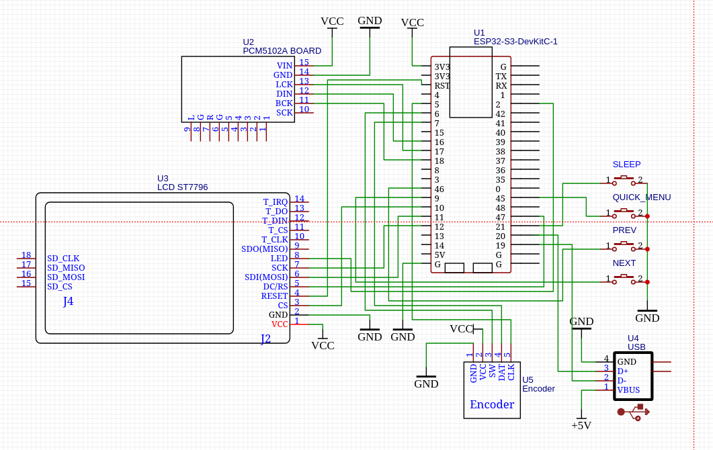
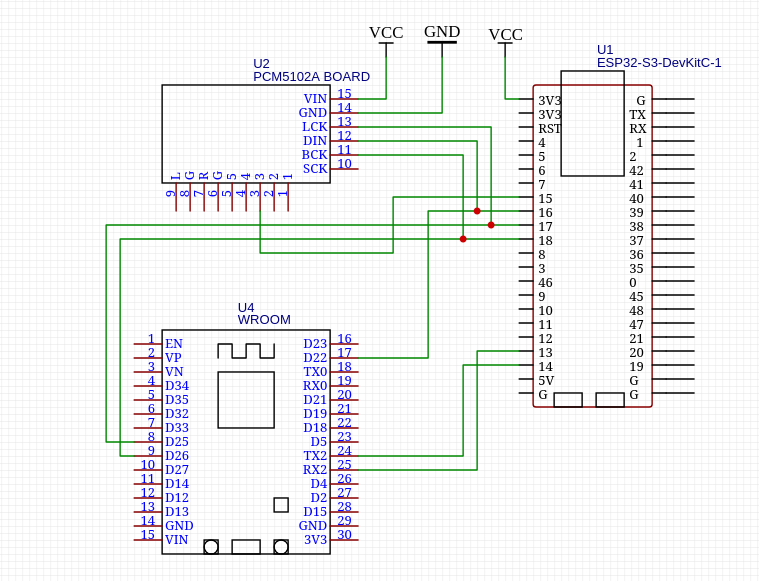
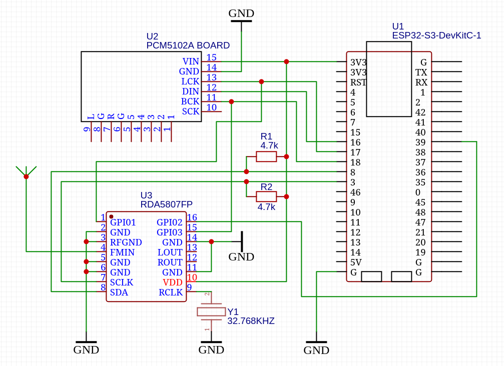
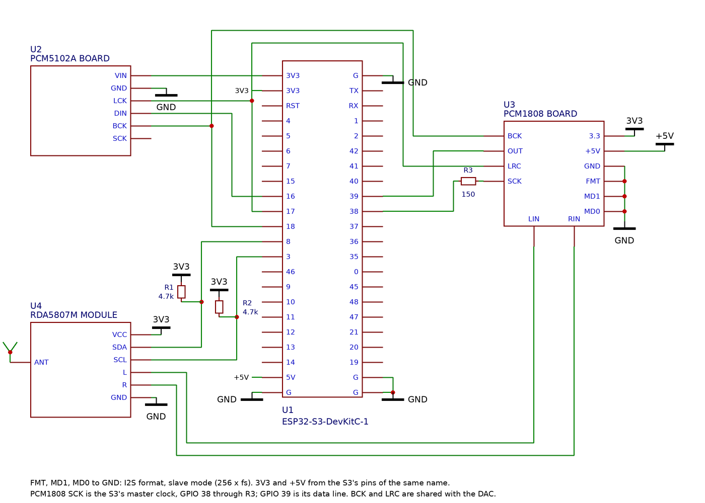

# Оборудование

[← README](../README.md) · [English](hardware.en.md)

## Состав

| Узел | Что подходит | Обязательно |
|---|---|---|
| Процессор | модуль ESP32-S3 с 16 МБ flash и 8 МБ PSRAM (например, ESP32-S3-WROOM-1 N16R8) | да |
| Дисплей | по SPI: ILI9341 или ST7789 320×240, ILI9488 или ST7796S 480×320, ST7789 320×170 | да |
| Энкодер | поворотный с кнопкой | да |
| ЦАП | PCM5102 (модуль с линейным выходом) | да |
| Кнопки | четыре тактовые: сон, быстрые настройки, назад, вперёд | нет |
| USB-флешка | разъём USB-A на выводах D−/D+ | нет |
| microSD | слот по SPI | нет |
| ИК-приёмник | трёхногий на 38 кГц: TSOP38238, VS1838B, HX1838 | нет |
| Bluetooth | второй модуль ESP32 (WROOM-32) с прошивкой [jradio-bt](https://github.com/jmper-ha/jradio-bt) | нет |
| FM-тюнер | RDA5807FP (цифровой звук по I2S) или модуль на RDA5807M (аналоговый выход, а через АЦП PCM1808 — тоже по I2S) | нет |
| Часы реального времени | DS3231 или DS1307 на I2C, с батарейкой — время без сети и будильник без Wi-Fi | нет |
| Усилитель | любой с входом MUTE / SD — прошивка глушит его на паузе | нет |
| Ключ питания периферии | load switch или P-MOSFET — обесточивает обвязку во сне | нет |

Всё необязательное подключается по желанию: чего нет на плате, того нет ни в
меню, ни в веб-интерфейсе.

## Как описать плату

Описание платы — какой дисплей, что стоит и на каких выводах — называется
распайкой. Прошивка читает её при каждом включении. Задать её можно двумя
способами:

- **В редакторе на сайте** — вкладка «Оборудование» на
  [jmper-ha.github.io/jradio](https://jmper-ha.github.io/jradio/). Выводы
  выбираются из списка или щелчком по рисунку модуля, проверка внизу не
  пропустит два сигнала на одном выводе и деталь без вывода. Распайка
  записывается на плату вместе с прошивкой, из того же браузера — см. [«Сборку
  и прошивку»](build.md#из-браузера). Ничего устанавливать не нужно.
- **В [`board_options.h`](../board_options.h)** — для сборки из исходников, см.
  ниже. `idf.py flash` пишет распайку из этого файла при каждой прошивке.

Правило одно для обоих: **всё, что подключено проводом, должно быть в
распайке.** Прошивка держит в нужном уровне только те выводы, о которых знает.
MUTE усилителя или XSMT ЦАПа, заведённый на GPIO, но не указанный в распайке,
оставит плату без звука — индикатор уровня будет ходить, динамики молчать.
Необязательная деталь, которой физически нет, — наоборот, выключается, и звук
от этого не пропадает.

## board_options.h

Для сборки из исходников плата описывается в
[`board_options.h`](../board_options.h) в корне проекта. Деталь выбирается
одной строкой, распиновка — строкой на вывод:

```c
#define DISPLAY   DISPLAY_ST7796S_480_320
#define AUDIO_DAC DAC_PCM5102
#define TFT_CS_GPIO 10
...
```

Допустимые имена деталей перечислены в
[`board_parts.h`](../components/board/include/board_parts.h). Опечатка
останавливает сборку, а не даёт молчащее устройство.

**Необязательные узлы включаются своим блоком строк, а выключаются его
удалением** (или комментарием): нет блока microSD — нет карты в меню; нет
строк `BUTTON_*_GPIO` — прошивка собирается с одним энкодером. Вместо энкодера
можно поставить три кнопки на те же три вывода: «+» на «Энкодер A», «−» на
«Энкодер B», «ОК» на кнопку энкодера, и включить «Три кнопки вместо энкодера»
в разводке (`ENCODER_AS_BUTTONS 1`) — или одно, или другое. Функции без
железа — Яндекс Музыка и DLNA — включаются строками `YANDEX_MUSIC` и `DLNA` со
значением `FEATURE_ON` или `FEATURE_OFF`.

## Распиновка по умолчанию

| Узел | GPIO | | Узел | GPIO |
|---|---:|---|---|---:|
| TFT CS | 10 | | Кнопка энкодера | 6 |
| TFT DC | 47 | | Энкодер A | 5 |
| TFT MOSI | 11 | | Энкодер B | 7 |
| TFT SCLK | 12 | | Кнопка Sleep | 21 |
| Подсветка | 2 | | Кнопка Quick_menu | 45 |
| PCM5102 DOUT | 16 | | Кнопка Prev | 46 |
| PCM5102 BCLK | 18 | | Кнопка Next | 9 |
| PCM5102 LRCK | 17 | | USB D− | 19 |
| microSD CS | 1 | | USB D+ | 20 |
| microSD SCK | 41 | | ИК-приёмник (по желанию) | 4 |
| microSD MISO | 40 | | UART для прошивки | 43, 44 |
| microSD MOSI | 42 | | | |

Типовая схема с этой распиновкой: ESP32-S3-DevKitC-1, дисплей ST7796S,
ЦАП PCM5102, энкодер, четыре кнопки и гнездо USB-A для флешки.



Что важно при разводке:

- **Прошивка идёт через UART (GPIO 43, 44), а не через USB-разъём.** USB
  отдан флешке, а встроенный USB-Serial-JTAG сидит на тех же выводах 19/20.
  Нужен мост USB-UART — на большинстве отладочных модулей он уже есть.
- **На гнездо флешки нужно подать 5 В.** ESP32-S3 сам питание на USB не
  выдаёт: VBUS гнезда — на +5 В платы, GND общий, D− на GPIO 19, D+ на GPIO 20.
  Если флешка вставлена через USB-разъём самой платы и OTG-переходник, на
  многих платах (например YD-ESP32-S3 / N16R8) 5 В на этот разъём идут только
  после замыкания перемычки «USB-OTG» («IN-OUT»). Признак, что питания нет: в
  журнале `usb: USB Host ready`, потом только `no drive yet; re-enumerating
  the root port` — флешка на шине так и не появляется.
- **Флешка — в FAT32 (или FAT16).** exFAT прошивка не читает; большие флешки
  с завода часто отформатированы именно в него.
- **Кнопка сна должна стоять на GPIO 0–21**: только эти выводы умеют будить
  чип из глубокого сна. То же относится к ИК-приёмнику, если пульт должен
  будить устройство.
- RST дисплея соединён с reset модуля. Если у вашего модуля RST выведен
  отдельно, назовите его строкой `TFT_RESET_GPIO` (в файле она есть,
  закомментированная).
- У microSD своя шина SPI3: у дисплея не разведён MISO, без которого карта не
  работает. Детект карты не разведён — карта определяется при входе в источник.
- Внутренние подтяжки у энкодера и кнопок включены всегда. Кнопку можно
  ставить прямо между выводом и землёй, без своего резистора; внешний не
  мешает.

## Дисплей

Панель и её ориентация задаются одним именем: `DISPLAY_ILI9341_320_240` —
горизонтально, `DISPLAY_ILI9341_240_320` — тот же модуль вертикально. Экраны
свёрстаны под каждую форму отдельно: в вертикальном положении в списках больше
строк, обложка встаёт над названиями, а не сбоку.

| Панель | Имена | Замечания |
|---|---|---|
| ILI9341 320×240 | `DISPLAY_ILI9341_320_240`, `DISPLAY_ILI9341_240_320` | самая распространённая, обе ориентации проверены |
| ST7789 320×240 | `DISPLAY_ST7789_320_240`, `DISPLAY_ST7789_240_320` | горизонтальная проверена, вертикальная выведена по аналогии |
| ST7789 320×170 (1,9") | `DISPLAY_ST7789_320_170` | только горизонтально; своя компактная раскладка |
| ILI9488 480×320 | `DISPLAY_ILI9488_480_320`, `DISPLAY_ILI9488_320_480` | 18-битный цвет по SPI, драйвер из реестра компонентов ставится сам; обе ориентации проверены |
| ST7796S 480×320 | `DISPLAY_ST7796S_480_320`, `DISPLAY_ST7796S_320_480` | по умолчанию в проекте; горизонтальная проверена |

Все панели подключаются одними и теми же шестью проводами (CS, DC, MOSI,
SCLK, подсветка, питание). Невыбранные драйверы в прошивку не попадают.

**Питайте панель от отдельного стабилизатора**, например AMS1117-3.3 от +5 В,
а не от вывода 3V3 модуля ESP32-S3: его LDO не тянет панель вместе со всем
остальным, и картинка мерцает — сильнее на полутонах и при большой яркости.
Конденсаторы на выводах модуля не помогают, проверено.

Отражение картинки по вертикали и горизонтали, если панель стоит не так, как
ожидалось, включается в настройках устройства — пересобирать ничего не нужно.

## Звук

**PCM5102** работает по I2S без MCLK: 16-битные стерео-слоты, BCLK = 32 × Fs.
На модуле:

- **SCK притяните к земле, XSMT — к 3,3 В.** Висящие в воздухе, они дают
  редкие пропадания звука при исправном цифровом тракте.
- Если XSMT отдан под управление прошивке (`AUDIO_DAC_MUTE_GPIO`, см. ниже),
  заводскую перемычку на 3,3 В нужно разорвать.

### Усилитель SSM3582 вместо ЦАПа

Вместо ЦАПа с линейным выходом и внешнего усилителя можно поставить
платный усилитель **SSM3582** — class-D 2×18 Вт со входом I2S и
управлением по I2C:

```c
#define AUDIO_DAC DAC_SSM3582
```

- Усилитель — ведомый по I2S (Philips, данные задержаны на такт), как
  PCM5102, и тактового сигнала не принимает. Его слоты должны быть не
  короче 32 бит — прошивка расширяет их сама, данные остаются
  16-битными. Частоты ниже 32 кГц чип на такой геометрии не
  поддерживает: он молчит, и прошивка пишет об этом в лог.
- Управление — по I2C0, той же шине и тем же выводам, что у тюнера RDA
  и часов: `FM_I2C_SDA_GPIO`, `FM_I2C_SCL_GPIO` (адрес 0x10, выводы
  ADDR0 и ADDR1 — на землю). Выводы ADDR задают адрес из шестнадцати
  (0x10…0x1F) при подаче питания — пять состояний на вывод: земля,
  47 кОм к земле, висит, 47 кОм к DVDD, DVDD. Если заземлены оба —
  0x10, он по умолчанию; иначе получившийся адрес надо назвать
  прошивке: `AUDIO_DAC_I2C_ADDRESS` в `board_options.h`.
- Громкость держит сам чип — свой регистр с плавным изменением; кривая
  совпадает с программной громкостью прошивки, но образцы при этом не
  приглушаются и шум не растёт. Вывод `AUDIO_AMP_GPIO` ему не нужен:
  открывание и запирание усилителя — тоже регистр (мягкое выключение,
  без щелчков).
- Верхнюю громкость — ту, что соответствует 100% — можно задать свою:
  `AUDIO_DAC_MAX_VOLUME_DB` в `board_options.h`, целое число дБ от −71
  до +24. Цифровой громкости чипа по силам не только приглушать, но и
  добавлять до +24 дБ, так что это не предел, который нельзя превышать,
  а место, где оказывается верх ручки; все шаги под ним сохраняют те же
  относительные интервалы, что и обычная кривая. Без этой строки верх —
  0 дБ, значение регистра после сброса. Целые дБ округляются к ближнему
  шагу 0,375 дБ; число вне диапазона не даёт собраться.

### Усилитель: вывод MUTE

Если стоит усилитель на динамики, отдайте прошивке его вход MUTE / SD /
standby:

```c
#define AUDIO_AMP_GPIO 39
#define AUDIO_AMP_ON_LEVEL 1     // уровень, при котором усилитель играет
```

Прошивка открывает усилитель только пока звук действительно идёт — на паузе,
на остановке и когда звук ушёл на Bluetooth-колонку он заглушен и не шипит в
динамики. Два правила против щелчков:

- подтяните вывод резистором к «тихой» стороне: во время сброса и первых
  миллисекунд загрузки им никто не управляет;
- глушить прошивка умеет сама — до остановки I2S, чтобы ЦАП, потерявший
  тактирование, не хлопнул в динамики.

### Обесточивание периферии во сне

Необязательный вывод `PERIPHERAL_POWER_GPIO` (свободны 38, 39, 48) управляет
ключом, который питает всё вне модуля: панель, ЦАП, карту, модуль Bluetooth,
USB. `PERIPHERAL_POWER_ON_LEVEL` — уровень, при котором ключ открыт (1 для
load switch, 0 для P-канального MOSFET в плюсе). В глубоком сне прошивка гасит
ключ и удерживает его закрытым; без этой строки спит только сам чип, а
подсветка и ЦАП продолжают потреблять.

Ключ должен держать ток всей обвязки с запасом: панель с подсветкой и модуль
Bluetooth на пиках берут заметно больше среднего.

## ИК-приёмник: пульт

Любой трёхногий приёмник на 38 кГц даёт полноценный пульт — как им
пользоваться, см. [«Пульт»](usage.md#пульт):

```c
#define IR_RECEIVER_GPIO 4
```

Подойдёт любой вывод, но чтобы пульт **будил** устройство из глубокого сна,
приёмник должен стоять на GPIO 0–21 и питаться от постоянных 3,3 В платы, а
не от линии периферии, которую сон выключает. Потребляет он доли миллиампера.
Без этой строки пульта нет — ни страницы в вебе, ни задачи приёмника.

## Bluetooth: модуль jradio-bt

У ESP32-S3 нет классического Bluetooth, а A2DP — его профиль. Поэтому
Bluetooth делает второй модуль — обычный ESP32-WROOM-32 с прошивкой
[jradio-bt](https://github.com/jmper-ha/jradio-bt). Он сидит на той же шине
I2S, что и ЦАП, и слушается по UART. Включается тремя строками:

```c
#define BLUETOOTH BLUETOOTH_JRADIO_BT
#define BT_UART_TX_GPIO 13
#define BT_UART_RX_GPIO 14
```

| S3 (jRadio) | WROOM (jradio-bt) | Что |
|---|---|---|
| GPIO 13 | GPIO 16 (RX) | UART 921600 8N1 |
| GPIO 14 | GPIO 17 (TX) | |
| GPIO 18 (BCLK) | GPIO 26 | общая шина I2S, через 33–47 Ом с каждой стороны |
| GPIO 17 (LRCK) | GPIO 25 | |
| GPIO 16 (DOUT) | GPIO 22 | тот же провод идёт и в DIN ЦАПа |
| GND | GND | |



На модуле **ESP32-WROVER** ножки 16 и 17 заняты памятью PSRAM, и прошивка для
него ведёт UART по другим: S3 GPIO 13 → WROVER GPIO 33 (RX), S3 GPIO 14 →
WROVER GPIO 32 (TX). На [странице прошивки
модуля](https://jmper-ha.github.io/jradio-bt/) для этого есть переключатель
WROOM/WROVER. Шина I2S та же.

Резисторы на линиях I2S нужны: при переключении того, кто ведёт шину (S3 или
модуль), обе стороны на миг могут оказаться выходами. Модуль появляется в
меню только пока отвечает по UART — отключённый или перепрошиваемый просто
не предлагается.

Чтобы встроенный ЦАП молчал, пока звук идёт на Bluetooth-колонку, заведите его
вывод XSMT на свободный GPIO:

```c
#define AUDIO_DAC_MUTE_GPIO 15
```

На фиолетовых модулях PCM5102 это площадка XMT, подтянутая к 3,3 В перемычкой —
перемычку разорвите, площадку соедините с GPIO (можно через 1 кОм). Без этой
строки ЦАП просто играет всегда.

## FM-радио: тюнер RDA5807

Тюнер управляется по I2C (адрес 0x11), поэтому ему нужна своя пара выводов:
шина SPI3 свободных выводов не оставляет. С тюнером в меню и в вебе появляется
источник «FM-радио»: частота крупными цифрами, название станции и радиотекст
по RDS, пресеты, сканирование диапазона и картинка у каждого пресета.



Два варианта чипа, и разница в звуке:

- **RDA5807FP** (SOP16) отдаёт звук цифровой шиной I2S. Он ведомый на тех же
  тактах BCLK и LRCK, что и ЦАП, а данные приходят в S3 на отдельный вывод
  DIN. Звук проходит тем же путём, что у любого источника: ручка громкости,
  ВУ-метр и запись в лог работают как обычно.
- У **RDA5807M** (обычный модуль) I2S на выводах нет, только аналоговый
  выход. Тогда строки про I2S не нужны, а звук снимается с выхода модуля на
  вход усилителя; громкость ручки действует на сам чип в 16 шагов.

```c
#define FM_TUNER FM_TUNER_RDA5807
#define FM_I2C_PERIPHERAL 0
#define FM_I2C_SDA_GPIO 8
#define FM_I2C_SCL_GPIO 3
// Только для RDA5807FP: звук по I2S0 и вывод DIN, любой свободный
#define FM_I2S_PERIPHERAL 0
#define I2S_DIN_GPIO 39
```

| S3 (jRadio) | RDA5807FP | Что |
|---|---|---|
| GPIO 8 | 8 (SDA) | I2C, подтяжка 4,7 кОм к 3V3 |
| GPIO 3 | 7 (SCLK) | I2C, подтяжка 4,7 кОм к 3V3 |
| GPIO 18 (BCLK) | 15 (GPIO3) | общие такты с ЦАПом |
| GPIO 17 (LRCK) | 1 (GPIO1) | общие такты с ЦАПом |
| свободный GPIO (на схеме 39) | 16 (GPIO2) | данные тюнера в S3 (DIN), вывод выбираете вы |
| 3V3 | 10 (VDD) | рядом с выводом советую 100 нФ и 10 мкФ на землю (на схеме их нет) |
| GND | 2, 3, 5, 6, 11, 14 | |
| | 4 (FMIN) | антенна, например провод около 75 см |
| | 9 (RCLK) | кварц 32,768 кГц на землю |

Выводы 12 и 13 (ROUT, LOUT) при цифровом звуке не используются.
Для DIN годится любой свободный вывод, выбор за вами: на схеме это 39, но
он же по умолчанию отдан усилителю (`AUDIO_AMP_GPIO`), и если усилитель нужен
тоже, DIN берите на другой. В редакторе оборудования
выводы тюнера выбираются в его карточке; пока они не выбраны, проверка их просит. Подтяжки на SDA и SCL
обязательны. RDS чувствителен к приёму: на слабом сигнале название
станции может не собираться, хотя звук играет хорошо, и помогает антенна
подальше от проводов платы.

### RDA5807M через АЦП PCM1808

У RDA5807M (обычный модуль) нет I2S, только аналоговый выход. Его звук можно
пустить тем же путём, что у любого источника, через АЦП PCM1808 на ту же шину
I2S0: громкость ручки, ВУ-метр и перелив на ЦАП работают как у RDA5807FP. АЦП
ведомый на тактах ЦАПа, отдаёт отсчёты в S3 на тот же вывод DIN и просит
главный такт 256×fs на вывод SCKI, который S3 выдаёт сам.

```c
#define FM_TUNER FM_TUNER_RDA5807
#define FM_I2C_PERIPHERAL 0
#define FM_I2C_SDA_GPIO 8
#define FM_I2C_SCL_GPIO 3
#define AUDIO_ADC AUDIO_ADC_PCM1808
#define I2S_DIN_GPIO 39
#define I2S_MCLK_GPIO 38
```

Вместо строк про I2S у RDA5807FP, а не вместе с ними: оба хотят одну линию DIN.
В редакторе оборудования всё это в одной карточке «FM-тюнер»: сначала микросхема
(RDA5807FP или RDA5807M). У FP звук всегда по I2S, и выбирать нечего: появляется
только вывод DIN. У M есть выбор звука — «Аналоговый выход» или «Через АЦП
PCM1808»; при АЦП к DIN добавляется вывод MCLK.



| S3 (jRadio) | PCM1808 | Что |
|---|---|---|
| GPIO 18 (BCLK) | BCK | общие такты с ЦАПом |
| GPIO 17 (LRCK) | LRCK | общие такты с ЦАПом |
| свободный GPIO (на схеме 39) | DOUT | данные АЦП в S3, вывод выбираете вы (см. выше про DIN) |
| свободный GPIO (на схеме 38) | SCKI | главный такт через 150 Ом, вывод выбираете вы |
| 3V3, GND | питание | |
| GND | FMT, MD0, MD1 | формат I2S, ведомый режим (256×fs) |
| | LIN, RIN | звук тюнера, см. ниже |

От RDA5807M берутся выводы LOUT и ROUT (на модуле они подписаны L и R) и земля.
**На каждый канал последовательно ставится конденсатор** 1–10 мкФ, плюсом к
тюнеру: выход RDA5807M несёт постоянное смещение, а вход АЦП должен быть
связан по переменному току. Многие готовые модули PCM1808 конденсаторы уже
содержат, у голого RDA5807M их нет.

Главный такт 11,3 МГц (при 44,1 кГц) даёт гармоники прямо в FM-диапазоне
(8-я на 90,3 МГц, 9-я на 101,6 МГц), и звучат они как раз тогда, когда он
нужен, — при приёме FM. Поэтому провод к SCKI лучше сделать коротким и
поставить в него резистор 100–220 Ом (на схеме 150) у самого S3: резистор
сглаживает фронты, и высокие гармоники слабеют. Пока играет не FM, такт АЦП не
нужен, и прошивка его выключает. Громкость тюнера для этого варианта 15
(максимум), уровень подбирается на слух.

## Часы реального времени: DS3231 или DS1307

Без них радио после отключения питания не знает времени, пока не ответит
сервер времени, а будильник за десять минут до звонка включает Wi-Fi, чтобы
поправить часы. С часами время есть сразу при включении, с сетью или без, и
тихое пробуждение будильника обходится без Wi-Fi. Время читается из часов при
загрузке и записывается в них после каждого ответа сервера времени (в часах
хранится UTC, так что часовой пояс их не касается).

Часы сидят на той же шине I2C0, что и FM-тюнер, на тех же двух выводах — есть
тюнер или нет:

```c
#define RTC_CHIP RTC_CHIP_DS3231      // или RTC_CHIP_DS1307
#define RTC_I2C_PERIPHERAL 0
#define FM_I2C_SDA_GPIO 8
#define FM_I2C_SCL_GPIO 3
```

В редакторе оборудования это карточка «Часы реального времени». Обе микросхемы
отвечают по адресу 0x68, так что на плате одна из них.

- **DS3231** работает от 3,3 В — так его и питайте: подтяжки модуля идут к его
  питанию, а выводы S3 5 В не выдерживают. Свой термокомпенсированный кварц,
  уход — секунды в месяц. Подтяжки модуля вместе с подтяжками шины тюнера
  (4,7 кОм) дают около 2,2 кОм — это нормально.
- **DS1307** питается от 5 В: ниже ~4,5 В он уходит на батарейку и отключает
  I2C. Подтяжки на его модуле тогда надо снять, оставив подтяжки к 3,3 В —
  он их понимает. Кварц внешний, уходит заметнее.
- **Батарейка.** На многих модулях стоит цепочка подзарядки для аккумулятора
  LIR (резистор и диод у держателя). С обычной батарейкой CR её нужно выпаять.
  Если после отключения питания в журнале «DS3231 lost the time» — батарейка
  села.

## Что показывает главный экран

Главный экран показывает ровно то, что есть на плате и включено в сборке:

- **железо** — по распайке: есть блок USB или microSD в `board_options.h` —
  есть источник;
- **функции** — по строкам `YANDEX_MUSIC` и `DLNA`.

Интернет-радио и «Настройки» есть всегда. Если в сборке не осталось ничего,
кроме них, главный экран не показывается вовсе: устройство включается сразу в
список станций, а долгое нажатие энкодера переключает между списком и
настройками.
