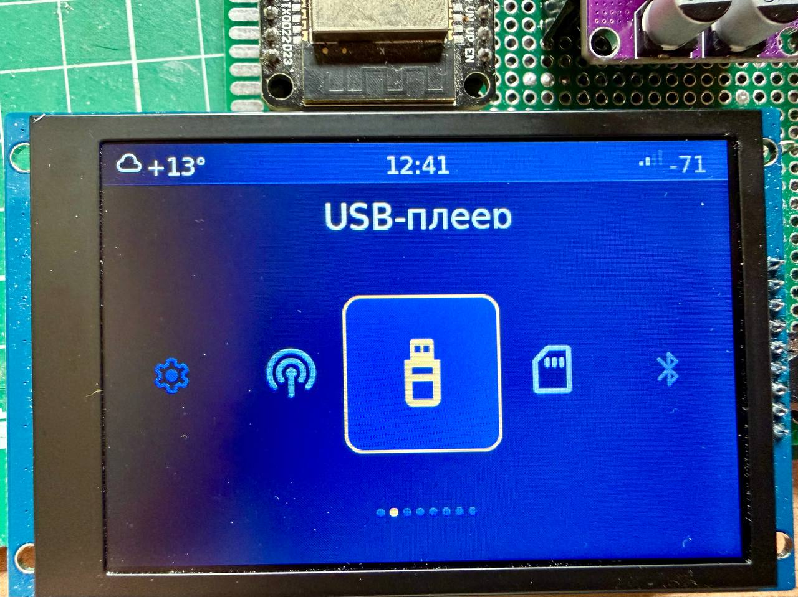
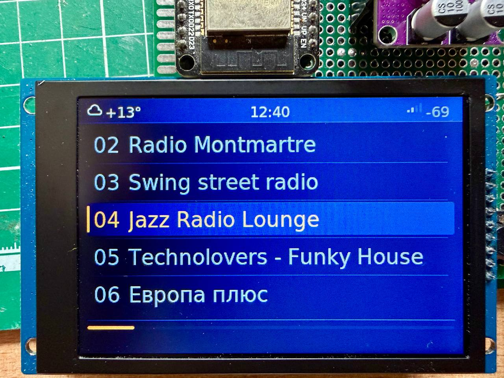
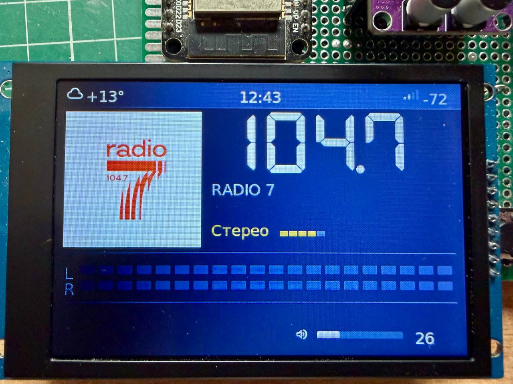
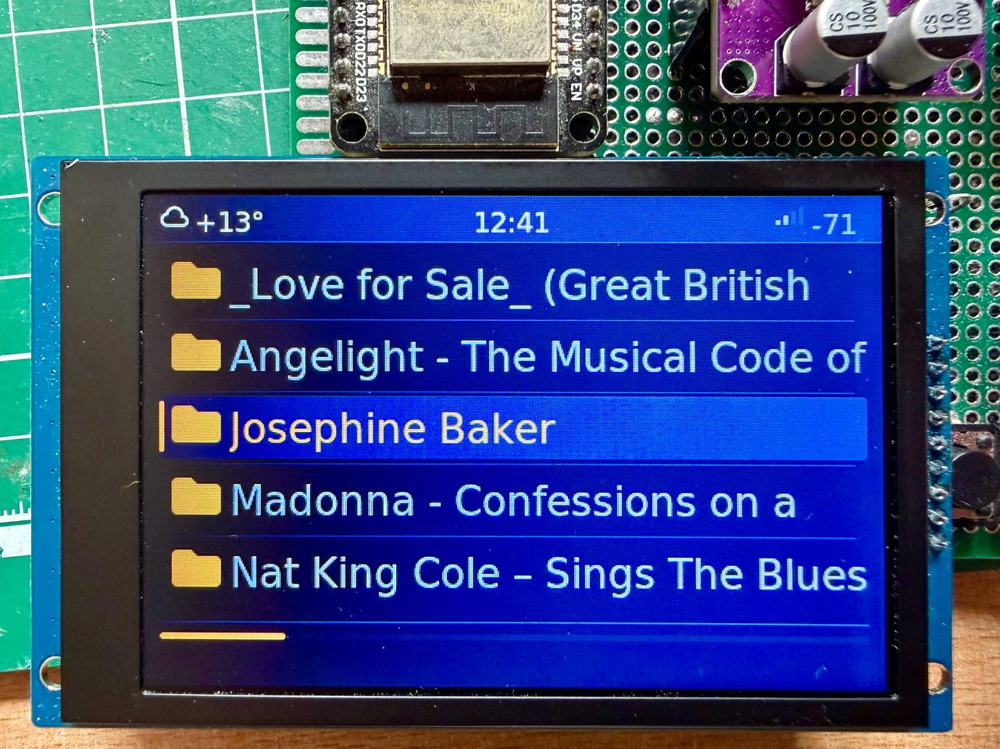
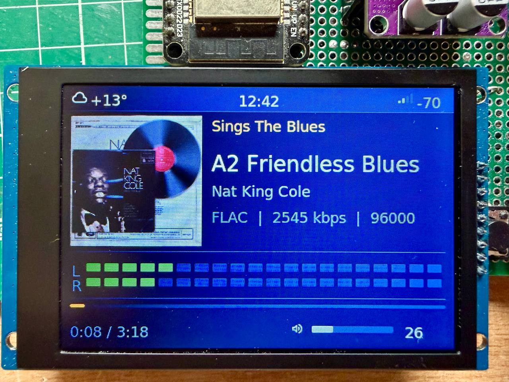
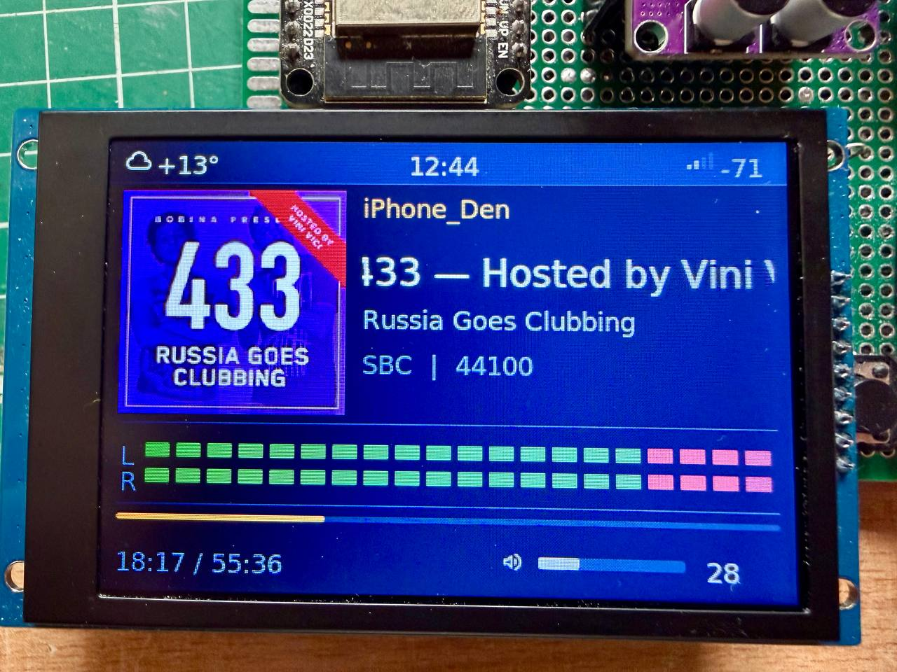
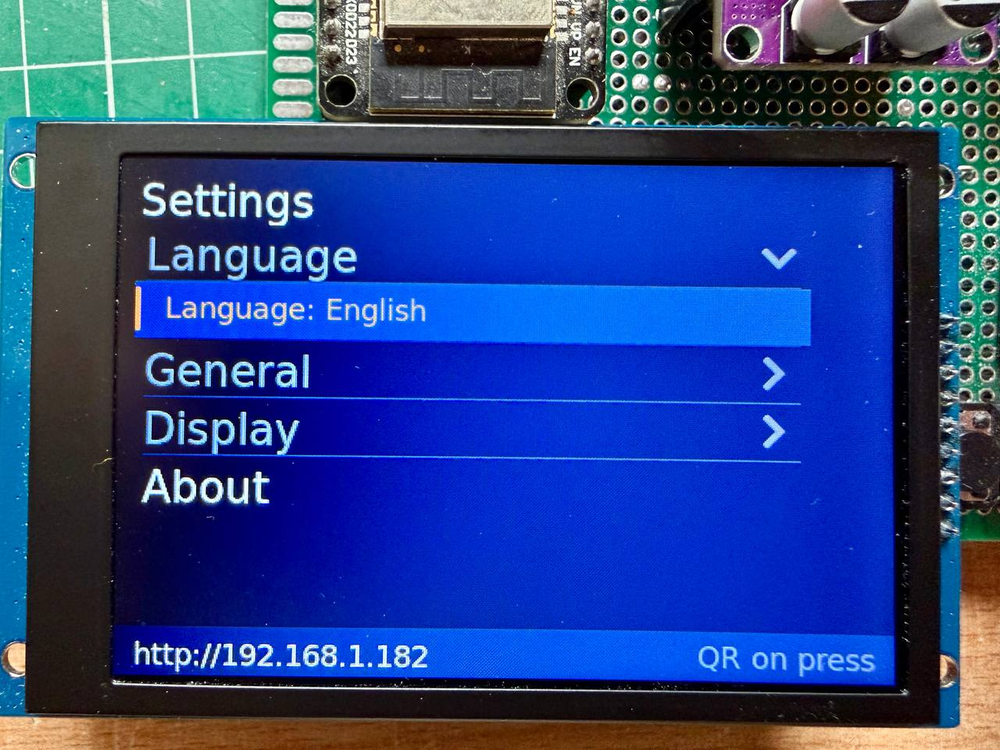

# Экраны

[← README](../README.md) · [English](screens.en.md)

Как выглядит jRadio на дисплее ST7796S 480×320 с темой «Стандарт». На других
дисплеях раскладка та же, только мельче; цвета меняются в настройках темы.

## Главный экран

Источники каруселью — энкодер листает, нажатие открывает. Вверху всегда
погода, часы и уровень Wi-Fi. Чего нет на плате, того нет и в карусели.

## Список станций

Номера те же, что набираются цифрами пульта и выбираются в будильнике.

## FM-радио

Частота крупно, название станции из RDS, картинка пресета, признак стерео и
уровень сигнала.

## Папки на флешке

Флешка и карта листаются одинаково: папки, файлы, длинные имена.

## Плеер файлов

Альбом, трек и исполнитель из тегов, обложка из файла или папки, формат и
битрейт, ВУ-метр, позиция в треке и громкость.

## Bluetooth

Звук с телефона через модуль jradio-bt: название трека и обложка приходят с
телефона, кнопки плеера управляют им.

## Настройки

Настройки прямо на устройстве, сгруппированные по разделам; внизу — адрес
веб-интерфейса, а по нажатию — QR-код для телефона.
